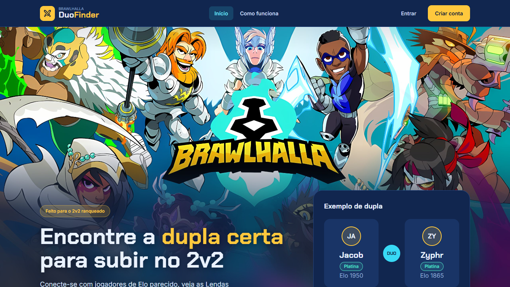
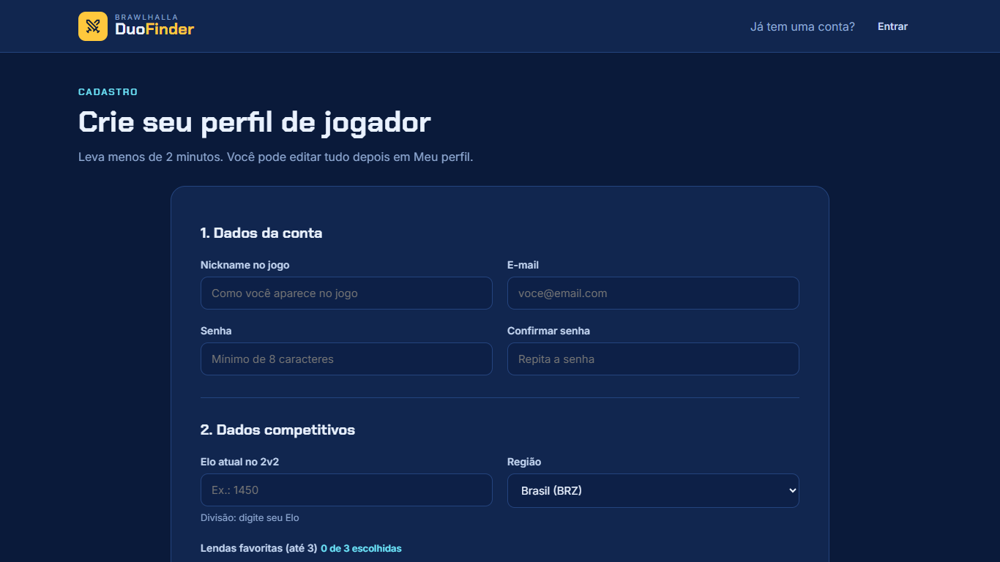
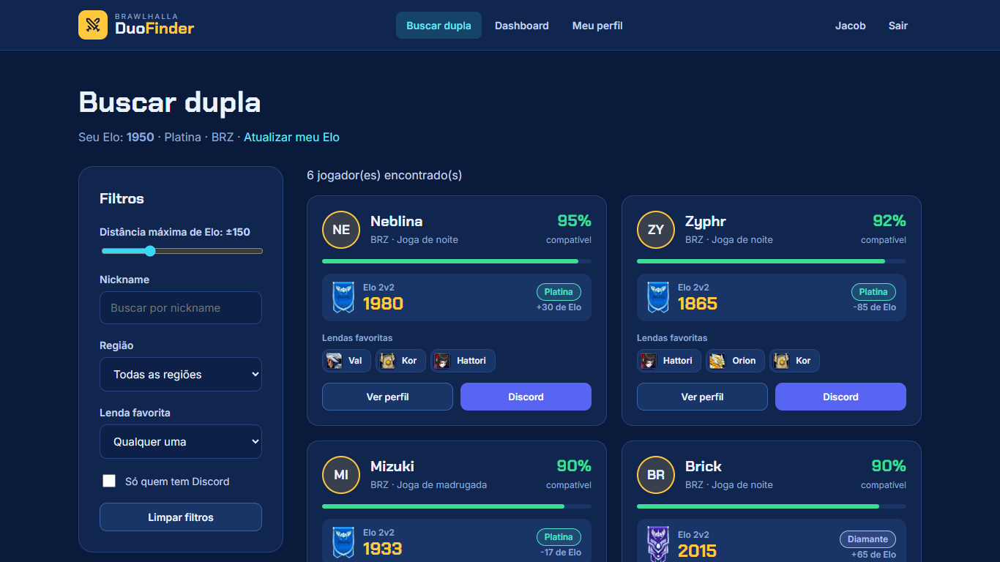
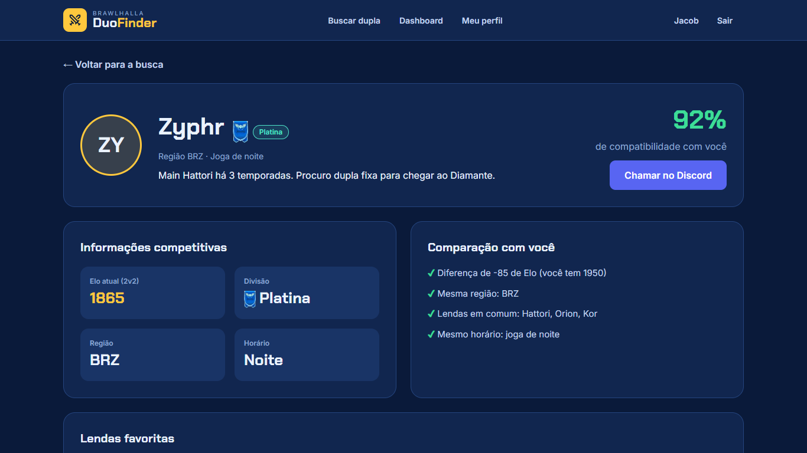
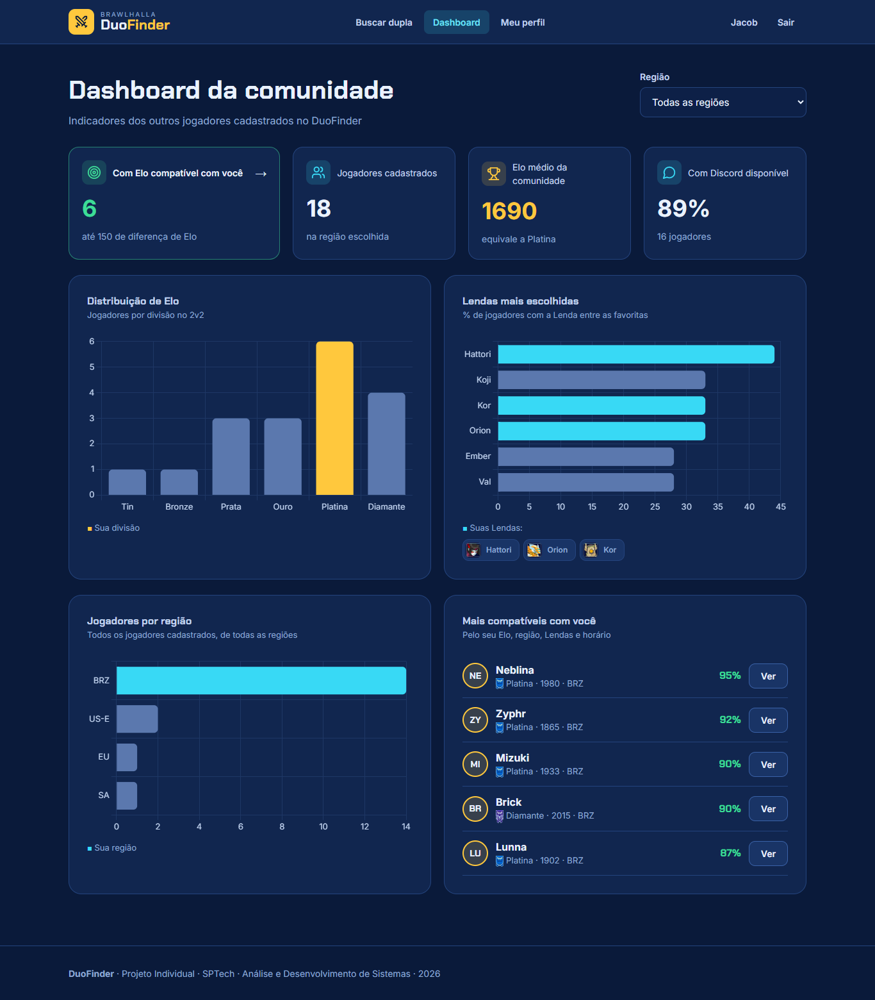

# Brawlhalla DuoFinder

Plataforma web para encontrar **parceiros para o 2v2 ranqueado de Brawlhalla**. O jogador cadastra seu Elo, sua região, seu horário e suas Lendas favoritas, e o DuoFinder mostra quem tem o perfil mais parecido com o dele, ordenado por compatibilidade. Quando encontra uma boa dupla, é só chamar no Discord.

Projeto individual do 1º semestre de **Análise e Desenvolvimento de Sistemas** na **SPTech**.



---

## Por que o DuoFinder existe

No 2v2 ranqueado, ganhar não depende só da habilidade individual: comunicação e entrosamento com o parceiro fazem muita diferença. Só que achar alguém com o **mesmo nível**, da **mesma região** e que jogue **no mesmo horário** é difícil. O DuoFinder junta essas informações num lugar só e aponta os jogadores que mais combinam com você.

---

## Como funciona

1. **Crie seu perfil**: informe seu nickname, seu Elo no 2v2, sua região, o horário em que costuma jogar e até 3 Lendas favoritas. O Discord é opcional, e você escolhe se ele aparece para os outros jogadores.
2. **Busque parceiros**: filtre por proximidade de Elo, nickname, região e Lenda. Os jogadores mais compatíveis aparecem primeiro.
3. **Veja o perfil**: compare as suas informações com as do outro jogador e veja o que vocês têm em comum.
4. **Chame no Discord**: combinem o horário e partiu ranqueada.

O DuoFinder não tem chat nem partidas próprias. Ele conecta você ao jogador certo, e o resto acontece no Discord e no jogo.

### Cadastro



### Busca de duplas

Os cards mostram o Elo, a divisão, as Lendas favoritas e a porcentagem de compatibilidade de cada jogador.



### Perfil do jogador



### Dashboard da comunidade

Indicadores e gráficos sobre os jogadores cadastrados: quantos têm Elo compatível com você, o Elo médio, a distribuição por divisão, as Lendas mais escolhidas e os jogadores por região. Tudo pode ser filtrado por região.



---

## As regras por trás

### Divisões

A divisão é calculada a partir do Elo do 2v2:

| Divisão | Elo |
|---|---|
| Tin | menos de 910 |
| Bronze | 910 a 1129 |
| Prata | 1130 a 1389 |
| Ouro | 1390 a 1679 |
| Platina | 1680 a 1999 |
| Diamante | 2000 ou mais |

### Compatibilidade

Cada jogador recebe uma porcentagem de compatibilidade com você:

- começa em **92%**
- perde **1 ponto a cada 10 de diferença** de Elo
- ganha **2 pontos por Lenda favorita em comum**
- ganha **2 pontos** se vocês jogam **no mesmo horário**
- perde **8 pontos** se vocês são de **regiões diferentes**
- o resultado fica sempre entre **10%** e **99%**

**Exemplo:** Jacob (Elo 1950) e Zyphr (Elo 1865) são do Brasil, jogam à noite e têm as mesmas 3 Lendas favoritas.
92 − 85 ÷ 10 + 3 × 2 + 2 = 91,5 → **92% de compatibilidade**.

---

## Tecnologias

| Parte | Tecnologia |
|---|---|
| Páginas | HTML, CSS e JavaScript |
| Gráficos | [Chart.js](https://www.chartjs.org/) |
| Banco de dados | MySQL |
| Servidor (API) | Node.js com Express, a partir da implementação de referência da SPTech |

---

## Como executar

**Você vai precisar de:** [Node.js](https://nodejs.org/) e [MySQL](https://dev.mysql.com/downloads/) instalados.

1. Clone o repositório.
2. No MySQL, execute o script `DuoFinder/src/database/script-tabelas.sql`. Ele cria o banco `duofinder`, as tabelas e alguns jogadores de exemplo. Se já existir um banco com esse nome, ele é apagado e criado de novo.
3. No arquivo `DuoFinder/.env.dev`, coloque os dados de acesso ao seu MySQL.
4. No terminal, dentro da pasta `DuoFinder`, rode:

   ```
   npm install
   npm start
   ```

5. Abra no navegador o endereço que aparecer no terminal (por padrão, `http://localhost:3333`).

**Usuário de teste:** `jacob@email.com` / senha `duofinder2v2`

---

## Organização das pastas

```
DuoFinder/
├── public/              páginas do site
│   ├── index.html       página inicial
│   ├── cadastro.html    cadastro
│   ├── login.html       login
│   ├── buscar.html      busca de duplas
│   ├── perfil.html      perfil de outro jogador
│   ├── meu-perfil.html  edição do próprio perfil
│   ├── dashboard.html   dashboard da comunidade
│   ├── css/             estilos de cada página e animações
│   ├── js/              lendas.js, duofinder.js (divisão, compatibilidade, sair) e Chart.js
│   └── assets/          imagens das Lendas e das divisões
├── src/                 API (rotas, controllers, models) e script do banco
└── docs/                especificação, plano de implementação e prints
```

---

## Créditos

- Servidor baseado na implementação de referência do **web-data-viz**, da SPTech.
- Projeto acadêmico sem vínculo com a Blue Mammoth Games ou a Ubisoft. Brawlhalla, a arte do banner, das Lendas e das bandeiras de rank pertencem à Blue Mammoth Games / Ubisoft.

Feito por [GustavoJacob1](https://github.com/GustavoJacob1).
